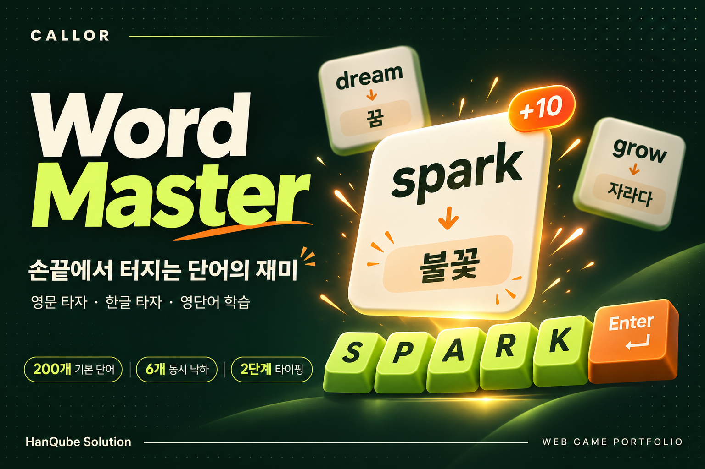

# Callor Word Master

## 손끝에서 터지는 단어의 재미



Callor Word Master는 **영문 타자, 한글 타자, 영단어 학습을 하나의 게임으로 연결한 웹 기반 타자연습 서비스**입니다. 화면 위에서 내려오는 영단어를 입력하고, 이어서 표시되는 한글 뜻까지 완성하면 단어가 불꽃 효과와 함께 사라집니다. 제한선에 도달하기 전에 두 단계의 입력을 마치는 과정에서 타이핑과 어휘 학습을 반복하도록 설계했습니다.

> 커버는 서비스의 콘셉트를 표현한 AI 생성 홍보용 이미지이며, 실제 실행 화면을 캡처한 이미지는 아닙니다.

## 프로젝트 개요

| 항목 | 내용 |
| --- | --- |
| 프로젝트명 | Callor Word Master |
| 분야 | 교육 · 타자연습 · 웹 게임 |
| 제작 | HanQube Solution / Callor |
| 대상 | 영어 어휘와 영문·한글 타이핑을 함께 연습하려는 사용자 |
| 화면 구성 | PC·태블릿·스마트폰을 고려한 반응형 웹 |
| 현재 버전 | v1.0.0 — 핵심 게임 및 시작 로비 구현 |
| 개발 방식 | ChatGPT와의 기획·반복 개선 및 Codex를 활용한 구현·검증 |
| 작성 기준 | 2026-11-03, 로컬 v1 소스와 프로젝트 변경 기록 |

## 플레이 방식

1. **게임 로비에서 시작** — 게임 방법을 확인하고 시작 버튼을 누릅니다. 로비에서는 게임이 진행되지 않습니다.
2. **영단어 선택** — 동시에 떨어지는 단어 중 원하는 영단어를 입력하고 Enter를 누릅니다.
3. **한글 뜻 완성** — 등록된 복수 뜻 중 무작위로 표시된 뜻을 한글로 입력합니다.
4. **클리어와 보상** — 두 단계를 완료하면 폭발 효과와 함께 10점을 얻습니다.
5. **다음 단어에 도전** — 단어가 제한선을 넘으면 생명이 줄어들고, 생명 소진 시 결과를 확인하거나 다시 시작할 수 있습니다.

예를 들어 `spark`를 입력한 뒤 화면에 표시된 `불꽃`을 입력하는 방식입니다. 뜻을 자유롭게 추측하는 퀴즈보다는, 표시된 단어와 의미를 직접 타이핑하며 익히는 학습 경험에 초점을 맞췄습니다.

## 주요 구현 기능

### 게임성을 더한 반복 학습

- 6개 단어를 동시에 제시하고, 사용자가 원하는 단어부터 입력하는 선택형 진행
- 단어의 위치·시작 높이·속도·정답 후 재등장 간격을 무작위로 구성
- 최근 출제 단어 30개를 활용한 반복 출제 억제
- 복수 한글 뜻 중 하나를 선택하고, 같은 단어의 직전 뜻을 우선 제외
- 단어 완성 시 10점, 콤보·남은 생명·클리어·놓친 단어 표시
- 게임 오버와 재시작, 게임에서 시작 화면으로 복귀

### 읽기 쉽고 몰입할 수 있는 화면

- 짙은 초록색과 라임색을 사용한 아케이드 스타일 시작 로비
- PC에서 브랜드·게임·설정을 분리한 3열 구성
- 섬광·충격파·파티클을 활용한 정답 피드백
- 영문과 한글 글자 크기 10·12·15·20·25pt 선택
- 게임 화면 라이트·다크 테마와 사용자 설정의 기기 저장
- 최초 실행 안내, 소리·효과 설정, 브라우저 전체화면
- 탭이 숨겨질 때 자동 일시정지, 지원 기기의 정답 진동 피드백

### 학습 데이터와 확장 기반

기본 단어 200개를 초급 100개, 기초 60개, 중급 40개로 구성했습니다. **현재 게임은 초급 100개를 출제**하며, 난이도 선택은 후속 확장 대상입니다. PostgreSQL·Prisma 스키마와 초기 단어 등록용 Seed를 준비했고, 단어와 복수 뜻을 별도 모델로 관리하도록 설계했습니다.

현재 게임 점수는 브라우저 메모리에서 관리하며 새로고침하면 초기화됩니다. 테마·글자 크기·소리·효과 등의 설정은 기기에 저장됩니다. 화면의 정확도는 오타율이 아니라 클리어한 단어가 클리어·놓친 단어 전체에서 차지하는 비율입니다.

## 기술 구성

| 영역 | 사용 기술 및 역할 |
| --- | --- |
| 웹 프레임워크 | Next.js 16 App Router |
| 화면과 게임 상태 | React 19, 클라이언트 상태 및 타이머 |
| 타입 검사 | TypeScript 7.0.2 — 전용 검사 명령으로 직접 실행 |
| 디자인 | Tailwind CSS 4, 사용자 정의 CSS, Lucide 아이콘 |
| 데이터 기반 | PostgreSQL·Prisma 7 스키마 및 Seed |
| 설정 저장 | 브라우저 localStorage |
| 품질 확인 | ESLint, TypeScript 검사, Next.js production build |

TypeScript 7을 기본 타입 검사 도구로 유지하면서, 기존 API가 필요한 도구에는 TypeScript 6 호환 패키지를 병행 적용했습니다. 빌드 전 TypeScript 7 검사를 실행하도록 구성했습니다.

## 개발 과정에서 해결한 문제

| 개선 과제 | 적용 방식 |
| --- | --- |
| 단일 단어 진행의 단조로움 | 다중 단어 선택 방식으로 확장하고 최종 6개 동시 출제 적용 |
| 반복 출제와 일정한 낙하 패턴 | 최근 단어 이력과 위치·속도·등장 간격 무작위화 |
| Enter 입력 후 포커스 이탈 | 단계 전환과 정답·오답 처리 후 입력창 포커스 복구 |
| 좌우 정보 패널이 단어를 가림 | 오버레이 구성을 독립적인 3열 레이아웃으로 변경 |
| 접속 직후 게임이 시작되는 부담 | 별도의 시작 로비와 명시적인 게임 시작 동작 도입 |
| 재시작 시 생명 표시 불일치 | 최대 생명 상수로 표시 값과 판정 값 통일 |
| TypeScript 7과 검사 도구의 호환성 | 호환 API 병행 설치 및 TypeScript 7 실행 경로 명시 |

## 향후 발전 방향

다음 항목은 **현재 구현 완료 기능이 아닌 후속 개발 계획**입니다.

- Auth.js 기반 Google·GitHub 로그인과 최초 가입자 관리자 권한
- 관리자 영단어·복수 한글 뜻 등록, 수정 및 비활성화
- 서버 기반 플레이 기록과 PointLedger 포인트 저장
- 개인 학습 기록과 랭킹
- 난이도 선택, 오답 복습 등 학습 기능 확장
- Kakao·Naver 로그인 확장

## 실행 및 검증 상태

프로젝트 폴더 `Callor-Word-Master-v1`에서 실행합니다.

```powershell
npm ci
npm run db:generate
npm run dev
```

개발 서버의 기본 주소는 `http://localhost:3000`입니다. 핵심 게임은 DB 연결 없이 실행할 수 있습니다. Prisma 코드 생성에는 프로젝트 환경 설정이 필요하며, DB 마이그레이션과 Seed는 별도의 데이터베이스 준비 작업입니다.

```powershell
npm run lint
npm run build
npm start
```

배포용 실행 포트는 `12320`입니다. `build`에는 TypeScript 7 검사가 포함됩니다.

2026-09-24 작업 기록 기준으로 코드 검사·타입 검사·배포용 빌드와 HTTP 응답 확인을 완료했습니다. 이번 포트폴리오 제작에서는 실행 검사를 다시 수행하지 않았습니다. 실제 브라우저 조작·모바일 화면 검증 및 남아 있는 의존성 보안 항목은 별도로 점검해야 합니다.

## 제작 정보

- 제작: **HanQube Solution**
- 문의: **callor@callor.com**
- 프로젝트: **Callor Word Master**
- 커버 파일: [Word-Master-포트폴리오.png](Word-Master-포트폴리오.png)
- 이미지 규격: **1536 × 1024px**, 요청한 1200 × 800px와 동일한 3:2 비율의 고해상도 원본
